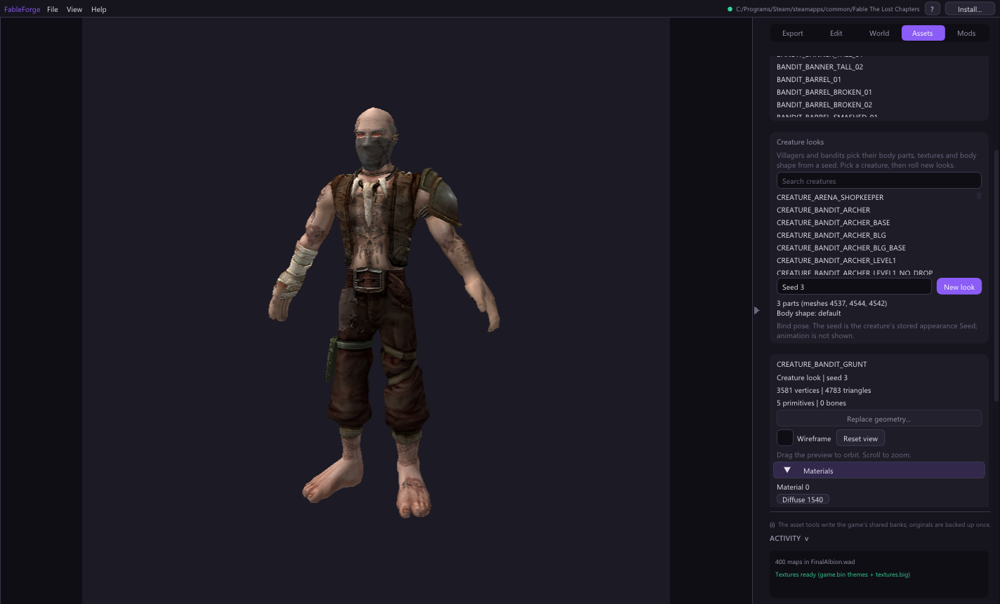

# Creature looks

Villagers and bandits are not one fixed model. Each one has a stored
*Seed*, and the game uses it to pick a head, torso and legs, swap their textures
and stretch the skeleton (fat, tall, short, strong, weak). **Creature looks**
shows you exactly what a seed produces, without starting the game.

1. Open **Assets > Models**. The **Creature looks** card is under the model list.
2. Search for a creature, for example `bandit_grunt`, and pick it. Only creatures
   that use random appearances are listed.
3. Type a **Seed** and press Enter, or press **New look** to roll a random one.
   The card lists the part meshes and the body shape that seed chose.
4. Drag the preview to orbit and scroll to zoom, as for any model.

The selection follows the game's own code, including its random-number generator
and the order it draws in, so a seed picks the same parts, textures and body
shape here as in the game.
The preview shows the creature in its bind pose (arms out); animation is not
played. Creatures without swappable body parts are refused with a message
instead of showing an incomplete model.
