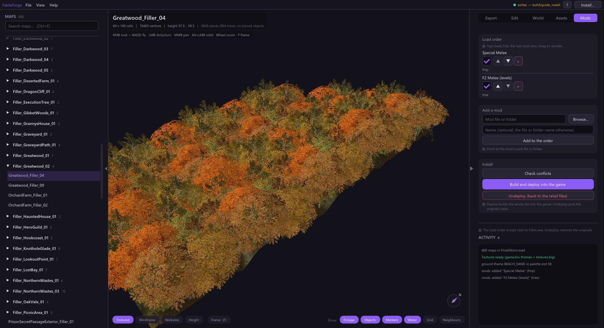

# Mod packs and load order

The **Mods** tab keeps one ordered list of every mod you want, builds them
together onto the selected installation and can undo the whole deploy. Supported
named definition records and level objects merge individually.

Whole overhauls can contain unnamed definition components that Forge cannot yet
match safely between edited banks. Changed or newly added unnamed source entries
stop the build instead of silently losing edits. Install and verify the overhaul
first, then choose its intact game folder as the baseline for supported named
mods. Do not add that overhaul again as a source. An unchanged unnamed baseline
copy is allowed; a sparse named-only source does not delete absent components.

## Add mods

Under **Add a mod**, browse to the mod's file or folder, optionally give it a name,
and press **Add to the order**. Supported kinds:

- Fable Mod Packages (`.fmp`)
- binary patches (`.patch`)
- quest files (`.qst`)
- folders containing a `Data/` tree
- EgoCore `Mods/<Name>/` folders
- FableForge packs (folders with `forge_pack.json`)

The tick box beside each row turns a mod off without removing it.

## Order them

If choosing a winner or clearing a saved choice fails, Mods keeps the error
visible beside the choices. The previous selection stays saved. Resolve the
reported file/access problem, then retry the choice.

The **top loads first and the last mod wins**. Drag a name, or use the arrows,
to reorder. Game records, a level's objects, text strings and world maps/regions
are merged; whole files such as texture banks come from the last mod that ships
them.

A FableForge pack can declare the mods it **requires**: right-click its row and
tick them. A pack whose requirements are missing or ordered after it is flagged in
the list and by the build.

## Check conflicts

**Check conflicts** dry-runs the whole order. Each row gains *wins* and *loses*
counts, and the Conflicts card lists every record, object, quest, string or file
that several enabled mods change differently. Edits that agree are not
conflicts. For each conflict you can keep the load-order winner, pick another
mod, or pick *vanilla*. Your picks are saved and applied by the next deploy.

For records merged by field, expand **Conflicting fields** to see each field's
winner and the mods that changed it. The record choice resolves contested fields;
other edits still merge. A selected mod only wins fields it changed. If it left
a field unchanged, the last mod that changed that field wins instead, with an
explanation beside the field. **Vanilla for conflicting fields** restores those
contested fields and keeps independent edits from the other mods.

Supported named scalar fields also have their own winner dropdown. A field
choice takes precedence over the record choice. **Current baseline** restores
that contested field; **record / load order** clears only its field choice.
Other independent edits still merge. The selected values and wins/loses counts
update immediately; Build and deploy applies the saved choices.

If a saved field source has no changed value in the current comparison, Forge
keeps the choice for review and uses the record choice. Choices whose targets
or field layouts are absent from the latest report appear under **Other saved
choices**, where you can clear them individually. Values describe the last
check; run Check conflicts again after updating your mods.

## Deploy and undeploy

**Build and deploy** first undoes the save folder's previous deployment, then
builds the whole order and installs the result, keeping the originals.
**Undeploy** restores those originals. Both refuse while Fable runs from that
destination. Failures stay visible beside the actions; Activity contains the
full diagnostics. If the new build fails after reverting a previous deployment,
the destination remains restored to its original files. Fix the input and retry.

After a deploy, the Edit tab marks objects that a mod placed or changed.
*Placed by* filters the object list by mod, and *Back to retail* on a selected
object records a vanilla pick for the next deploy.

## Make your own pack

Your editor work can go into a pack instead of straight into the game:

1. Create a pack from **Assets** (*Models*, *Ground themes* or *Dialogue*:
   **New pack**). It joins the load order.
2. At the bottom of the Edit panel, set **Writes go into** to that pack.
3. Object, terrain, world and new-level writes now go into the pack. Nothing in
   the game changes until **Build and deploy**.

Packs are folders you can share; another FableForge user adds the folder to their
order. The format and merge rules are in [MOD_PACKS.md](../modding/MOD_PACKS.md).
For Aeon Edition with Controller Support, follow the
[Aeon/controller walkthrough](../walkthrough/aeon-controller/index.html).
