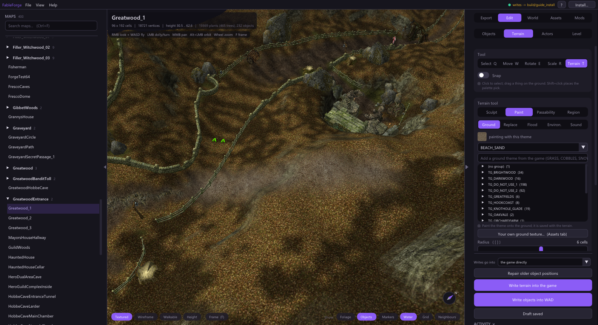
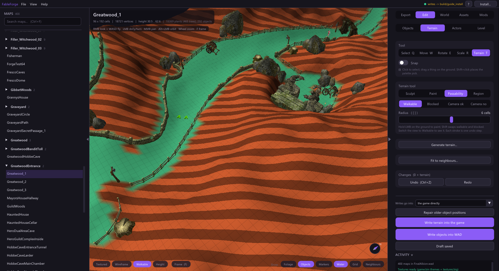

# Paint the ground

Open a map, then **Edit > Terrain** (or press T). The **Terrain tool** card has
four groups: **Sculpt** (heights), **Paint** (what the ground looks and sounds
like), **Passability** (where the hero and camera may go) and **Region** (copy and
paste). Every stroke is one undo step (Ctrl+Z).

## Pick a sculpting height

With Raise, Lower, Flatten, Smooth, Noise or Paths selected, hold Ctrl and drag
on the ground to sample its height without changing it. **Paint height** shows
the current sample. Switch to **Flatten** to level the ground to that height.
Hold `-` or `=` in a sculpt tool to lower or raise a fixed ground spot. Moving
the pointer keeps the edit at its starting point; release finishes the stroke.
**Speed** is available in each sculpt tool. Hover it to see the height-key step.
With **Exact step** in Raise/Lower, or with Flatten, small brushes show dots on
the vertices they affect. A 0.25-cell radius affects one vertex.
Smooth also shows its considered vertices; its radius rounds down to a whole
cell, with a minimum of 1. Smooth may leave flat ground and straight slopes as they are.
Noise shows a square enclosing its possible random pokes.
While a height key is held, small brushes show the key pen's distinct vertices.
At a radius of 0.25 or 0.5 it reaches none; increase **Radius** when prompted.

## Ground textures

1. Choose **Paint > Ground**.
2. Pick a theme under *painting with this theme*. The list holds the map's own
   palette. To use another theme from the game, type in *Add a ground theme from
   the game* (grass, cobbles, snow...) and choose one; it takes a free palette
   slot. The engine's placeholder (`INVALID_THEME_STANDIN`) is not offered; until
   you pick a theme, painting is refused with a note.
3. Hold the left mouse button on the ground. **Radius** sets the brush size
   (`[` and `]`), **Strength** how quickly the theme blends in.

**Full stamp** sets every considered vertex fully to the theme in one
application. It uses a strict disc centred on a truncated vertex; small cursors
show the vertices. Strength is hidden while Full stamp is on. Switch it off to
keep soft blending.

Hide **Foliage** in the chips at the bottom of the view to see the ground under
trees. Your own picture can become a theme too: *Your own ground texture...*
opens **Assets > Ground themes**.

**Replace** turns one theme into another under the brush. **Flood** does it for a
whole connected patch with one click, like the vanilla editor. For both, Ctrl+click
the ground to pick the theme to paint and Ctrl+Shift+click to pick the theme to
replace.
Replace's small cursor shows the vertices it considers; only matching themes
change. It truncates the pointer to a vertex and excludes the radius boundary,
so a radius of 1 considers one vertex.

**Environ.** and **Sound** paint the map's environment (lighting and atmosphere)
and ambient sound regions. Ctrl+click samples what is already under the cursor.
Small Sound brushes outline each 4x4 cell they touch; even a 0.25-cell brush
paints the cell containing its rounded ground vertex.
Environ. sets each touched 4x4 cell fully to the chosen environment. Its small
brush outlines the cells; *(no environment)* clears them. Radius 1 considers
only the pointer's truncated vertex, which can differ from Sound's brush.
Switch Environ. from **Paint** to **Smear** to blend each reached cell with its
neighbours. Small brushes outline the cells; increase **Radius** if prompted.
Smear has a minimum effective radius of 1 and works within this map. Holding
the mouse keeps blending; Ctrl+Z undoes the whole stroke.
With *(no sound)* chosen, **Clear all sounds on this map** removes every ambient
sound in one step; with a sound chosen, the same button fills the whole map with it.
Older `.lev` files without a game-map grid do not offer these two.

## Walkable and camera areas

Choose **Passability**, then switch the view to **Walkable** (bottom left). Green
is walkable, red is blocked.

- **Walkable / Blocked** paint where the hero can walk. Shift swaps the two while
  you paint.
- **Camera ok / Camera no** paint where the camera may pass. Walkable ground is
  always camera-passable, so this matters on cliffs, walls and water edges.

**Shore** paints shore-point flags with **On** or **Off**. Hold Shift to reverse
the stroke. **Show shore points** marks set cells in translucent red; small
brushes show the affected vertices. The flags save with terrain and undo as one
stroke. The visible water shoreline comes from water generation.

Walkable, Blocked, Camera ok and Camera no use a rounded vertex pen. Small
brushes show the affected vertices; a radius of 0.25 reaches one vertex and a
radius of 1 reaches nine. Extra boundary vertices are excluded.

Painting walkability changes the map's navigation by patching the game's existing
navigation data. It does not regenerate navigation for a whole map.

## Write it into the game

Sound and Environ. show their regions in the themes' editor colours. Sound can
show all sounds, only the selected sound, or be switched off. Environ. has its
own **Show colours** toggle. Both update during painting and undo. Colour chips
in the theme pickers select that theme. These are region labels, rather than
previews of audible sound or the game's lighting.

Painted themes, walkability and heights are all part of the terrain. Press
**Write terrain into the game** at the bottom of the Edit panel (or *Write terrain
into pack ...* when *Writes go into* names a pack). Moved or placed objects are a
separate write: **Write objects into WAD**.

When both changed (objects standing on reshaped ground move with it), the panel
offers **Write terrain and objects into the game** with one confirmation. It
writes the terrain first and the objects only after that succeeded; if the
terrain write fails, nothing else is written and both edits stay in the draft.

Start a new game or enter the map fresh to see the change; see the
[engine rules](../ENGINE_RULES.md).
